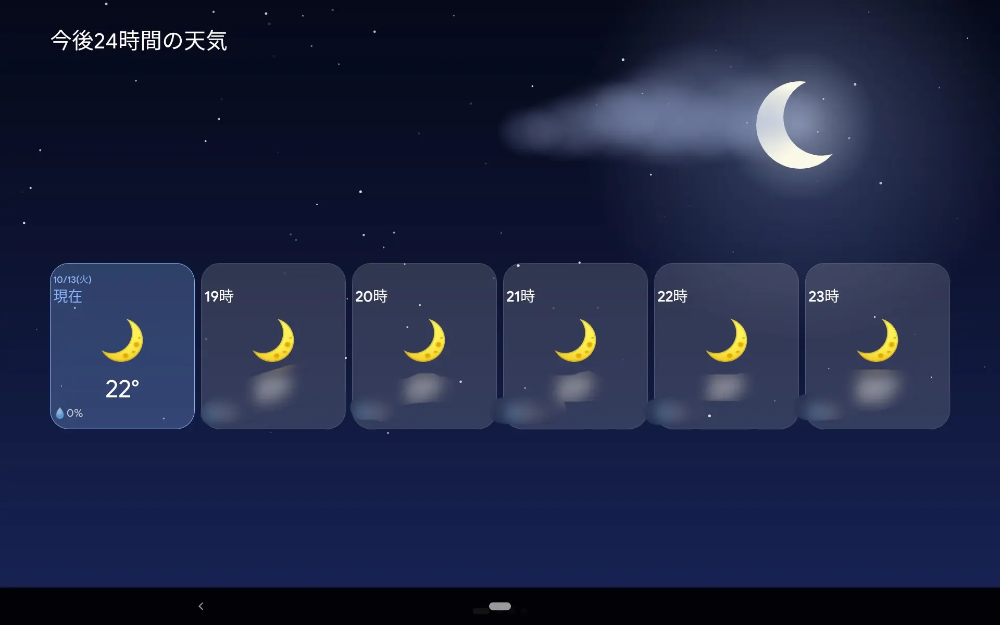
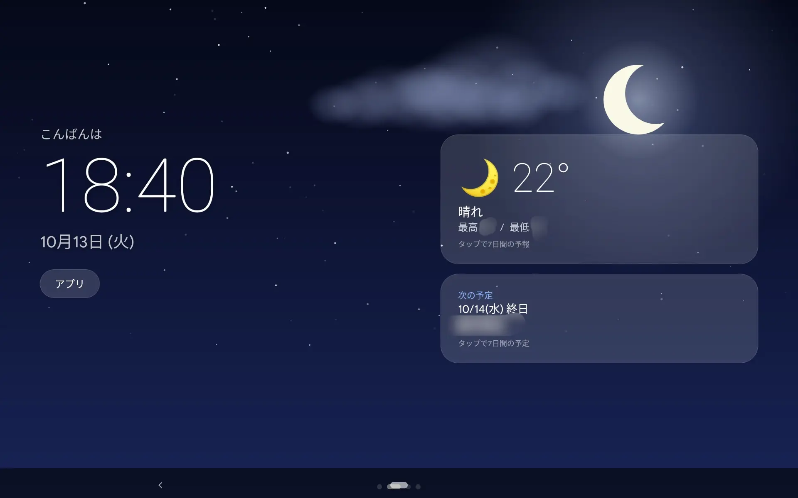
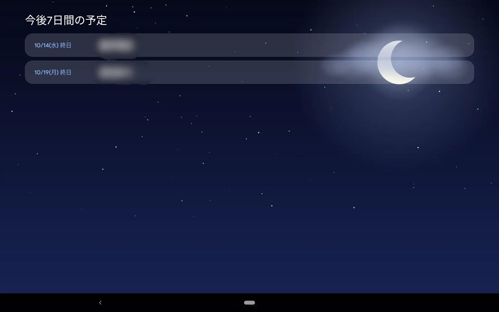
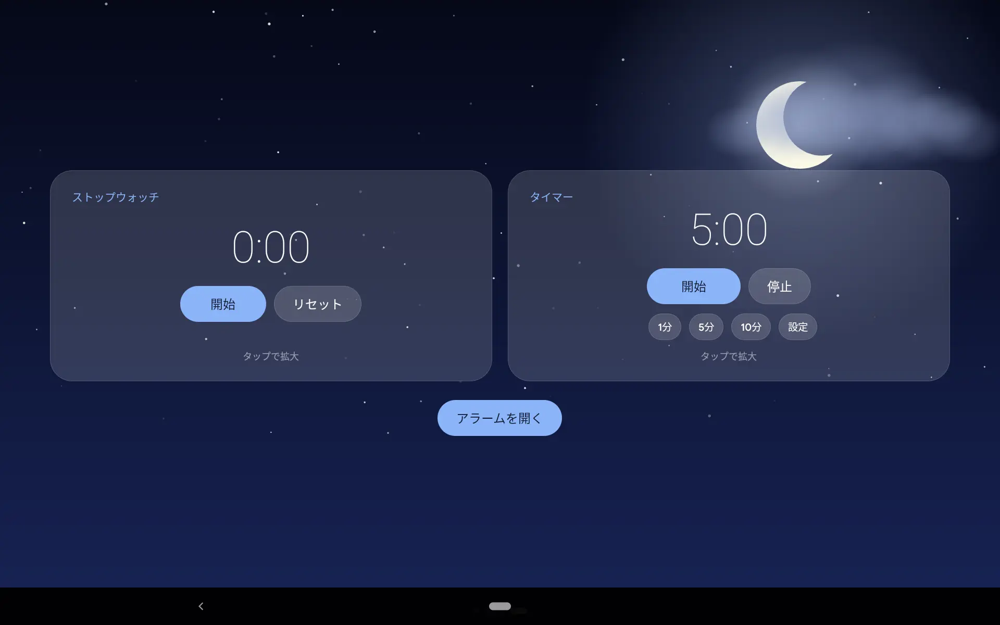

<p align="center">
  
</p>

# Every Launcher

Every Launcher は、Android 9（API 28）以降向けのスマートディスプレイ風アプリです。  
横向きの画面で、時計・天気・予定・タイマーを横スワイプで切り替えて使えます。

ホームアプリとして設定できるほか、Androidのスクリーンセーバー一覧にも登録されます。  
スクリーンセーバーが起動すると、メイン画面を開きます。

Every Launcher is a landscape smart-display app for Android 9 and later.  
It provides clock, weather, calendar, stopwatch and timer screens.  

It can be selected as a home app or as a system dream; starting the dream opens the main activity.

> [!IMPORTANT]
> このアプリは個人開発であり、Google LLC とは関係ありません。  
> Google の Nest Hub などのスマートディスプレイにインスパイアされていますが、「Nest」「Nest Hub」は Google LLC の商標です。

## スクリーンショット

左から右へスワイプする順に並んでいます（起動時はホームです）。

<table>
  <tr>
    <td align="center"><br>今後24時間の天気</td>
    <td align="center"><br>ホーム</td>
  </tr>
  <tr>
    <td align="center"><br>今後7日間の予定</td>
    <td align="center"><br>ストップウォッチ・タイマー</td>
  </tr>
</table>

## 機能

| ページ | 内容 |
|---|---|
| 1時間ごとの天気（左端） | 現在から24時間分の予報を横スクロールで表示 |
| **ホーム** | 時計、日付、現在の天気、次の予定、アプリ一覧 |
| 予定 | 端末のカレンダーから今後の予定を表示 |
| ツール | ストップウォッチ、タイマー、アラームアプリへのショートカット |

### 操作

- 時計をタップすると、秒まで表示する拡大時計を開きます。
- 天気カードをタップすると、7日間の予報を表示します。
- 次の予定カードをタップすると、予定ページへ移動します。
- ストップウォッチまたはタイマーのカードをタップすると、拡大表示します。閉じるボタンまたは戻る操作で閉じます。
- ページは横方向にドラッグまたはフリックして切り替えます。時間ごとの予報帯の上では帯をスクロールできます。

### タイマー

- 1・3・5・10分のプリセットと、時・分・秒を指定する自由設定があります。
- 開始、一時停止、再開、停止に対応します。
- 終了時はアラーム音を最大1分間鳴らします。停止または次の開始操作で止められます。アラーム音量が0の場合は、音量を最大値の半分に設定します。

### 天気・背景

- 天気予報は[Open-Meteo](https://open-meteo.com/)からAPIキーなしで取得します。天気は約15分ごとに更新します。
- 背景は天候と昼夜に合わせて変化します。天気写真があれば写真に動きや天候エフェクトを重ね、写真がなければアプリ内の描画で表示します。
- 写真の追加方法は[天気画像ガイド](WEATHER_IMAGES.md)を参照してください。写真はリポジトリに含まれていません。

### スクリーンセーバー

Androidの「設定」からスクリーンセーバーとしてEvery Launcherを選べます。スクリーンセーバーが開始すると`LauncherActivity`を起動します。設定画面の場所や名称は端末メーカーにより異なります。

## 動作環境と権限

- Android 9（API 28）以降。画面は横向きです。
- 天気の取得にはインターネット接続とおおよその位置情報が必要です。
- 予定の表示にはカレンダーへのアクセスが必要です。

| 権限 | 用途 |
|---|---|
| `INTERNET` | 天気予報の取得 |
| `ACCESS_COARSE_LOCATION` | 現在地の天気を取得 |
| `READ_CALENDAR` | 端末の予定を表示 |

位置情報は天気を取得するためにOpen-Meteoへ送信されます。  
カレンダーの内容は端末内でのみ読み取ります。  
広告(Ad)・解析(Analyze)・ログイン(Token)機能はありません。

## インストール

ビルドと端末へのインストール手順は[INSTALL.md](INSTALL.md)を参照してください。

## ビルド環境

| 項目 | バージョン |
|---|---|
| Android Gradle Plugin | 8.13.2 |
| Gradle | 8.14.6 |
| JDK | 21 |
| minSdk | 28 |
| targetSdk | 36 |
| 言語 | Groovy & Java |

AGP 9.x 以降では Kotlin が強制的に梱包されるため、8.x で止めています。

## プロジェクト構成

```text
EveryLauncher/
├─ .github/workflows/       # GitHub Actions のビルド
├─ docs/                    # README、インストール、天気画像ガイド
├─ app/src/main/
│  ├─ AndroidManifest.xml   # ホームアプリ・スクリーンセーバー登録
│  ├─ java/jp/aburipan/everylauncher/
│  │  ├─ LauncherActivity.java
│  │  ├─ screensaver/       # スクリーンセーバー
│  │  ├─ calendar/          # カレンダーの取得
│  │  ├─ timer/             # タイマー・ストップウォッチ
│  │  ├─ ui/                # 共通UIとページ
│  │  └─ weather/           # 天気データ・背景描画
│  ├─ res/                  # 文字列やアイコン等のリソース
│  └─ assets/weather/       # 同梱する天気画像（任意）
└─ LICENSE
```

このアプリはJavaコードで構築しています。  
AndroidXなどの外部ライブラリは使用していません。

## カスタマイズ

| 内容 | 主な場所 |
|---|---|
| 共通の余白・文字サイズ・色 | `ui/UiDimensions.java`、`ui/UiTextSizes.java`、`ui/UiColors.java` |
| ページ構成・ホーム画面 | `LauncherActivity.java`、`ui/pages/` |
| 天気データの取得・表示 | `weather/WeatherRepository.java`、`weather/WeatherView.java` |
| 天気写真 | `app/src/main/assets/weather/` またはアプリの外部ファイル領域 |
| 日本語・共通文字列 | `app/src/main/res/values-ja/strings.xml`、`app/src/main/res/values/strings.xml` |

## 制限事項

- 現在の画面は横向き表示です。
- 位置情報の取得には、端末で位置情報が有効である必要があります。
- 天気アイコンには絵文字を使っているため、端末のフォントで見た目が変わる場合があります。
- 背景アニメーションは画面表示中に動作し、バッテリーを消費します。

## クレジット

天気データ: [Open-Meteo](https://open-meteo.com/)（[CC BY 4.0](https://creativecommons.org/licenses/by/4.0/)）。利用条件を確認して使用してください。

## ライセンス

[MIT License](../LICENSE)
